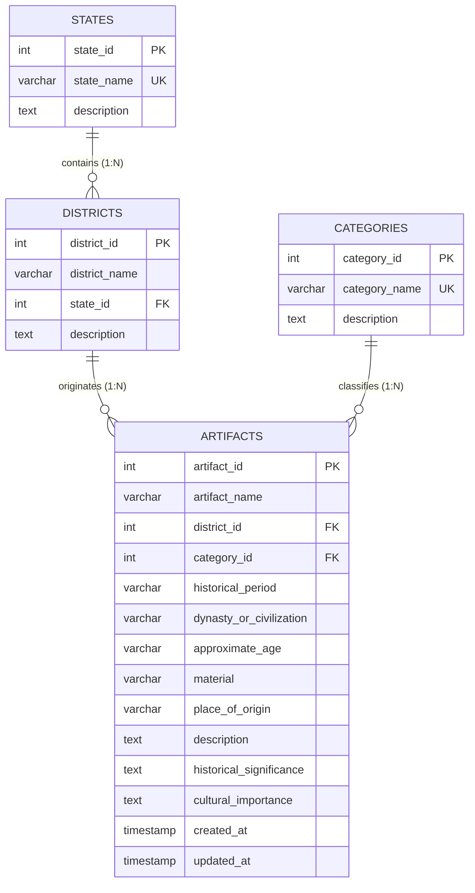

# 🏛️ HeritageArchive – Historical Artifact Information System
### Relational Database & Express REST API Backend for Indian Heritage Antiquities

HeritageArchive is a curated historical artifact management platform documenting the material heritage, epigraphy, numismatics, and classical metallurgical traditions across the Indian subcontinent.

---

## 📑 Table of Contents
1. [Architecture & ER Relationships](#-architecture--er-relationships)
2. [Database Schema & Tables](#-database-schema--tables)
3. [Importing Database via phpMyAdmin (XAMPP)](#-importing-database-via-phpmyadmin-xampp)
4. [Backend Setup & Execution](#-backend-setup--execution)
5. [REST API Endpoints Reference](#-rest-api-endpoints-reference)
6. [SQL Verification & Testing Queries (15 Queries)](#-sql-verification--testing-queries)
7. [Frontend Integration Details](#-frontend-integration-details)
8. [Deliverables Summary](#-deliverables-summary)

---

## 📐 Architecture & ER Relationships

The database is normalized to 3NF using MySQL/MariaDB with the **InnoDB** storage engine to enforce foreign key referential integrity.



### Relational Integrity Rules:
- **`states` ➔ `districts`**: `ON DELETE RESTRICT`, `ON UPDATE CASCADE`. Prevents accidental deletion of a state while districts are assigned to it.
- **`districts` ➔ `artifacts`**: `ON DELETE RESTRICT`, `ON UPDATE CASCADE`. Prevents deletion of a district that holds historical artifact records.
- **`categories` ➔ `artifacts`**: `ON DELETE RESTRICT`, `ON UPDATE CASCADE`. Prevents removing antiquity categories with active artifact records.
- **Unique composite key**: `(district_name, state_id)` ensures district names cannot be duplicated within the same state.

---

## 🗄️ Database Schema & Tables

All tables are defined in [`database/historical_artifact_db.sql`](database/historical_artifact_db.sql).

| Table | Primary Key | Description | Record Count in Seed |
| :--- | :--- | :--- | :--- |
| **`states`** | `state_id` (INT Auto) | Indian states hosting historical monuments and finding sites | **15 states** |
| **`districts`** | `district_id` (INT Auto) | Administrative districts & historical archaeological zones | **78 districts** |
| **`categories`** | `category_id` (INT Auto) | Antiquity classifications (Bronzes, Coins, Inscriptions, etc.) | **10 categories** |
| **`artifacts`** | `artifact_id` (INT Auto) | Individual catalogued antiquities with findspot, dynasty & age | **68 authentic records** |

---

## 💻 Importing Database via phpMyAdmin (XAMPP)

Follow these manual steps to import the database into MySQL using phpMyAdmin:

### Step 1: Start XAMPP Services
1. Open the **XAMPP Control Panel**.
2. Click **Start** next to **Apache**.
3. Click **Start** next to **MySQL**.
4. Ensure both modules turn green and show active ports (default: Apache `80/443`, MySQL `3306`).

### Step 2: Open phpMyAdmin
1. In your browser, navigate to: `http://localhost/phpmyadmin/`
2. You will see the phpMyAdmin dashboard.

### Step 3: Import the SQL File
1. In the top navigation bar, click the **Import** tab.
2. Under **File to import**, click **Choose File** (or *Browse*).
3. Select the file from your project:
   ```
   <PROJECT_ROOT>/database/historical_artifact_db.sql
   ```
4. Verify character set is set to **utf-8**.
5. Scroll down and click **Import** (or **Go**).

### Step 4: Verify the Database & Tables
1. In the left sidebar of phpMyAdmin, click on **`historical_artifact_db`**.
2. Confirm the four tables appear:
   - `states` (15 rows)
   - `districts` (78 rows)
   - `categories` (10 rows)
   - `artifacts` (68 rows)
3. Click on any table and select the **Browse** tab to inspect the records.

### How to Re-Import Safely:
- The script includes `DROP TABLE IF EXISTS` in reverse dependency order (`artifacts` ➔ `districts` ➔ `categories` ➔ `states`), allowing you to re-import at any time to reset to a clean state.
- If you have inserted custom rows you wish to preserve, edit the script to remove the `DROP TABLE` block and use `INSERT IGNORE` statements.

---

## 🚀 Backend Setup & Execution

The backend is built with **Node.js, Express, and mysql2** in the `backend/` directory.

### 1. Configure Environment Variables
Inside the `backend/` folder, copy `.env.example` to create `.env`:
```bash
cd backend
cp .env.example .env
```
*(On Windows PowerShell: `Copy-Item .env.example .env`)*

Configure your MySQL credentials in `backend/.env`:
```env
PORT=5000
DB_HOST=localhost
DB_PORT=3306
DB_NAME=historical_artifact_db
DB_USER=root
DB_PASSWORD=
```
> **Note for XAMPP users:** Default user is `root` with an **empty** password (`DB_PASSWORD=`). If you set a root password in phpMyAdmin or use a custom user, enter it after `DB_PASSWORD=`.

### 2. Install Dependencies
Dependencies are already configured in `backend/package.json`:
```bash
cd backend
npm install
```

### 3. Start the Backend Server
```bash
npm start
```
Or for auto-reloading development:
```bash
npm run dev
```

### 4. Verify Backend & Database Connectivity
Open your browser or run curl:
- `http://localhost:5000/api/health`
Expected JSON output when MySQL is running and imported:
```json
{
  "status": "OK",
  "database": {
    "connected": true,
    "message": "Database connected successfully"
  }
}
```

---

## 📡 REST API Endpoints Reference

All endpoints return standard JSON responses and support parameterized queries.

| Method | Endpoint | Description |
| :--- | :--- | :--- |
| `GET` | `/api/health` | Check backend server & MySQL database connectivity |
| `GET` | `/api/states` | List all states with district & artifact counts |
| `GET` | `/api/states/:id` | Get single state by numeric ID or name slug |
| `GET` | `/api/districts` | List all districts (optional `?stateId=1`) |
| `GET` | `/api/districts/state/:stateId` | List all districts belonging to a specific state |
| `GET` | `/api/districts/:id` | Get single district by numeric ID or name |
| `GET` | `/api/categories` | List all 10 artifact categories with counts |
| `GET` | `/api/categories/:id` | Get single category by ID |
| `GET` | `/api/artifacts` | List artifacts with pagination (`page`, `limit`, `sortBy`) |
| `GET` | `/api/artifacts/:id` | Get single artifact with JOINed state, district, & category |
| `GET` | `/api/artifacts/district/:districtId` | List all artifacts in a specific district |
| `GET` | `/api/artifacts/category/:categoryId` | List all artifacts in a specific category |
| `GET` | `/api/artifacts/search?q=coin` | Search artifact names, materials, eras, & descriptions |
| `GET` | `/api/artifacts/filter` | Multi-criteria filter (`stateId`, `districtId`, `category`, `period`, `dynasty`) |
| `GET` | `/api/artifacts/statistics` | Aggregate counts of artifacts, states, districts, and categories |
| `GET` | `/api/artifacts/featured` | Featured artifacts showcase |
| `GET` | `/api/artifacts/:id/related` | Related artifacts from same category or dynasty |

---

## 🔍 SQL Verification & Testing Queries

These 15 verification queries can be executed in phpMyAdmin's **SQL** tab to verify data integrity:

### 1. Display all states
```sql
SELECT state_id, state_name, description FROM states ORDER BY state_name ASC;
```

### 2. Display districts belonging to a selected state
```sql
SELECT d.district_id, d.district_name, s.state_name, d.description
FROM districts d
JOIN states s ON d.state_id = s.state_id
WHERE s.state_id = 1
ORDER BY d.district_name ASC;
```

### 3. Display all artifact categories
```sql
SELECT category_id, category_name, description FROM categories ORDER BY category_id ASC;
```

### 4. Display all artifacts (overview)
```sql
SELECT artifact_id, artifact_name, historical_period, dynasty_or_civilization, material
FROM artifacts
ORDER BY artifact_id ASC;
```

### 5. Display artifact details with district, state, and category names using JOINs
```sql
SELECT 
    a.artifact_id,
    a.artifact_name,
    c.category_name,
    d.district_name,
    s.state_name,
    a.historical_period,
    a.dynasty_or_civilization,
    a.approximate_age,
    a.material,
    a.place_of_origin
FROM artifacts a
JOIN districts d ON a.district_id = d.district_id
JOIN states s ON d.state_id = s.state_id
JOIN categories c ON a.category_id = c.category_id
ORDER BY a.artifact_id ASC;
```

### 6. Search artifacts by name using LIKE
```sql
SELECT a.artifact_id, a.artifact_name, a.dynasty_or_civilization, a.material
FROM artifacts a
WHERE a.artifact_name LIKE '%Bronze%'
ORDER BY a.artifact_name ASC;
```

### 7. Filter artifacts by state (e.g., Tamil Nadu)
```sql
SELECT 
    a.artifact_id,
    a.artifact_name,
    s.state_name,
    d.district_name,
    c.category_name
FROM artifacts a
JOIN districts d ON a.district_id = d.district_id
JOIN states s ON d.state_id = s.state_id
JOIN categories c ON a.category_id = c.category_id
WHERE s.state_name = 'Tamil Nadu';
```

### 8. Filter artifacts by district (e.g., Thanjavur)
```sql
SELECT 
    a.artifact_id,
    a.artifact_name,
    d.district_name,
    a.material,
    a.historical_period
FROM artifacts a
JOIN districts d ON a.district_id = d.district_id
WHERE d.district_name = 'Thanjavur';
```

### 9. Filter artifacts by category (e.g., Category ID 1)
```sql
SELECT 
    a.artifact_id,
    a.artifact_name,
    c.category_name,
    a.dynasty_or_civilization,
    a.material
FROM artifacts a
JOIN categories c ON a.category_id = c.category_id
WHERE c.category_id = 1;
```

### 10. Filter artifacts by historical period
```sql
SELECT 
    a.artifact_id,
    a.artifact_name,
    a.historical_period,
    a.dynasty_or_civilization
FROM artifacts a
WHERE a.historical_period LIKE '%Chola%';
```

### 11. Count artifacts in each state
```sql
SELECT 
    s.state_id,
    s.state_name,
    COUNT(a.artifact_id) AS total_artifacts
FROM states s
LEFT JOIN districts d ON s.state_id = d.state_id
LEFT JOIN artifacts a ON d.district_id = a.district_id
GROUP BY s.state_id, s.state_name
ORDER BY total_artifacts DESC, s.state_name ASC;
```

### 12. Count artifacts in each category
```sql
SELECT 
    c.category_id,
    c.category_name,
    COUNT(a.artifact_id) AS total_artifacts
FROM categories c
LEFT JOIN artifacts a ON c.category_id = a.category_id
GROUP BY c.category_id, c.category_name
ORDER BY total_artifacts DESC, c.category_name ASC;
```

### 13. Count artifacts in each district
```sql
SELECT 
    d.district_id,
    d.district_name,
    s.state_name,
    COUNT(a.artifact_id) AS total_artifacts
FROM districts d
JOIN states s ON d.state_id = s.state_id
LEFT JOIN artifacts a ON d.district_id = a.district_id
GROUP BY d.district_id, d.district_name, s.state_name
HAVING total_artifacts > 0
ORDER BY total_artifacts DESC, d.district_name ASC;
```

### 14. Retrieve related artifacts from the same category
```sql
SELECT 
    a.artifact_id,
    a.artifact_name,
    a.dynasty_or_civilization,
    a.material
FROM artifacts a
WHERE a.category_id = (SELECT category_id FROM artifacts WHERE artifact_id = 1)
  AND a.artifact_id != 1
LIMIT 5;
```

### 15. Test Foreign Key Integrity (Referential Integrity Check)
```sql
-- A) Test Invalid Insert (Foreign key district_id 9999 does not exist)
-- Expected Result: ERROR 1452 (23000): Cannot add or update a child row: a foreign key constraint fails
INSERT INTO artifacts (artifact_name, district_id, category_id) 
VALUES ('Invalid Artifact', 9999, 1);

-- B) Test Delete Restrict on Parent (State #1 has existing districts)
-- Expected Result: ERROR 1451 (23000): Cannot delete or update a parent row: a foreign key constraint fails
DELETE FROM states WHERE state_id = 1;

-- C) Test Delete Restrict on Parent (District #1 has existing artifacts)
-- Expected Result: ERROR 1451 (23000): Cannot delete or update a parent row: a foreign key constraint fails
DELETE FROM districts WHERE district_id = 1;
```

---

## 🎨 Frontend Integration Details

The frontend application (`src/services/api.js`) is connected to the backend REST API:
- Automatically issues HTTP requests to `http://localhost:5000/api`.
- Normalizes relational database fields (`state_name`, `district_name`, `category_name`, `artifact_name`, etc.) into the exact object models used by the existing React components.
- Preserves the existing **navy, gold, and cream** design theme without modifying or breaking UI components.
- Provides intentional development fallback to the local offline dataset when the backend server is offline or being migrated.

---

## 📦 Deliverables Summary

1. `database/historical_artifact_db.sql` — Complete SQL script creating `historical_artifact_db`, 4 InnoDB tables, constraints, 15 states, 78 districts, 10 categories, 68 artifacts, and 15 testing queries.
2. `backend/package.json` — Backend project definition with Express, mysql2, cors, and dotenv.
3. `backend/.env.example` — Configuration template for MySQL connection.
4. `backend/config/db.js` — Connection pool and connection health testing.
5. `backend/controllers/` — Controllers for states, districts, categories, and artifacts.
6. `backend/routes/` — Express route definitions for all REST endpoints.
7. `backend/server.js` — Server initialization with CORS, health check, and error handlers.
8. `src/services/api.js` — Client API service layer connecting frontend to backend.
9. `README.md` — Complete reference guide.
